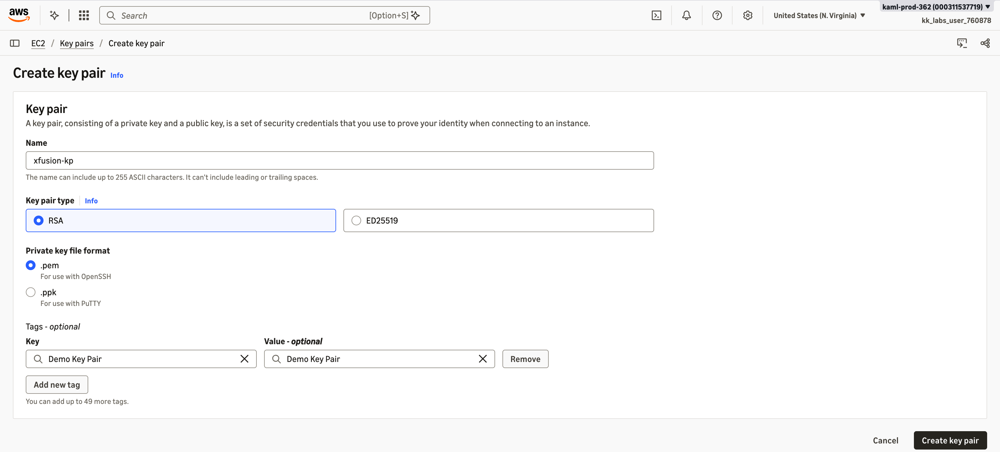
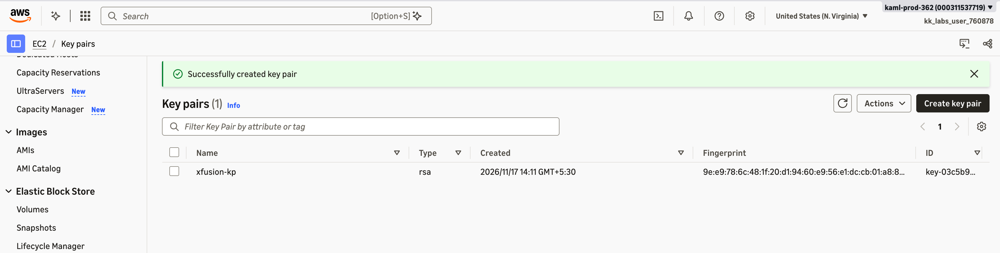
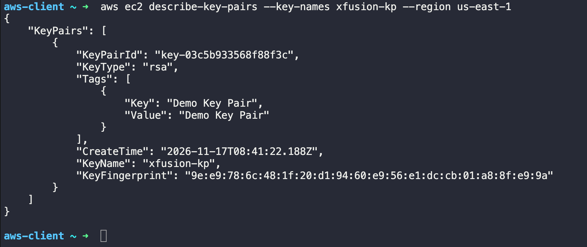
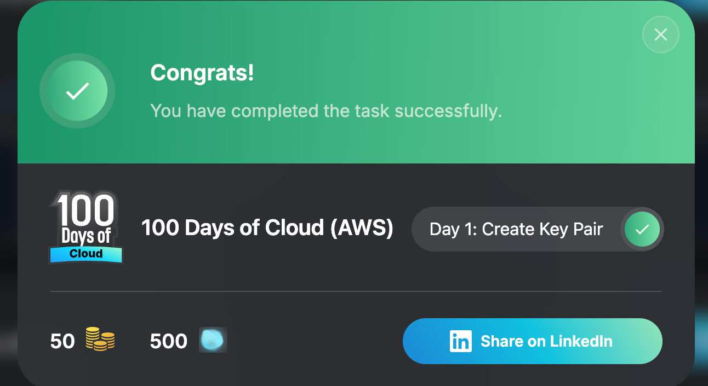

# Day - 1: Create Key Pair

## Problem Statement

The Nautilus DevOps team is strategizing the migration of a portion of their infrastructure to the AWS cloud. Recognizing the scale of this undertaking, they have opted to approach the migration in incremental steps rather than as a single massive transition. To achieve this, they have segmented large tasks into smaller, more manageable units. This granular approach enables the team to execute the migration in gradual phases, ensuring smoother implementation and minimizing disruption to ongoing operations. By breaking down the migration into smaller tasks, the Nautilus DevOps team can systematically progress through each stage, allowing for better control, risk mitigation, and optimization of resources throughout the migration process.

For this task, create a EC2 key pair with the following requirements:

* Name of the "key pair" should be "xfusion-kp".

* Key pair type must be "rsa"

---

Use below given AWS Credentials: (You can run the `showcreds` command on `aws-client` host to retrieve these credentials)

| Console URL | https://000311537719.signin.aws.amazon.com/console?region=us-east-1 |
| Username | kk_labs_user_760878 |
| Password | YqSG^52q!Iah |
| Start Time | Tue Nov 17 08:11:37 UTC 2026 |
| End Time | Tue Nov 17 09:11:37 UTC 2026 |

Notes:

* Create the resources only in "us-east-1" region.

---

## Solution

### Using AWS Console

1. **Sign in** using the Console URL from the task, with the username and password it gives you.
2. **Check the region** in the top-right corner. It must say **N. Virginia (us-east-1)**. If it doesn't, switch it.
3. Open **EC2**: search "EC2" in the top search bar and click it.
4. In the left sidebar, under **Network & Security**, click **Key Pairs**.
5. Click **Create key pair** (top right).
6. Fill in the form:
   - **Name:** `xfusion-kp`
   - **Key pair type:** `RSA`
   - **Private key file format:** `.pem` (the default for Linux/macOS/OpenSSH. Use `.ppk` only for PuTTY.)
7. Click **Create key pair**. The `.pem` file downloads automatically. This is your only chance to download it, so keep it safe.
8. **Verify:** `xfusion-kp` should now appear in the Key Pairs list with type `rsa`.



### Using AWS CLI

```bash
# Run `showcreds` first if you need the credentials

aws configure          # enter the access key, secret key, region: us-east-1

# Create the key pair and save the private key locally
aws ec2 create-key-pair \
  --key-name xfusion-kp \
  --key-type rsa \
  --query 'KeyMaterial' \
  --output text \
  --region us-east-1 > xfusion-kp.pem

# Restrict permissions (SSH refuses keys that are too open)
chmod 400 xfusion-kp.pem

# Verify
aws ec2 describe-key-pairs --key-names xfusion-kp --region us-east-1
```

The verify output should show `"KeyType": "rsa"` and `"KeyName": "xfusion-kp"`.

### Common mistakes to avoid

- Creating it in the wrong region. Key pairs are regional, so the checker will look only in us-east-1.
- Choosing `ed25519` instead of `rsa`. The type can't be changed later.
- A typo in the name. Key pair names can't be renamed, so you would have to delete and recreate it.

### Key Takeaways

1. **A key pair is public-key cryptography for EC2 login.** AWS stores the public key and you keep the private key. When you launch an instance with the key pair, the public key is placed on the instance.
2. **The private key is shown only once.** AWS doesn't keep a copy, so if you lose the `.pem`, you can't recover it.
3. **Key pairs are region-scoped.** A key pair in `us-east-1` can't be used in `eu-west-1`, which is why the task stresses the region.
4. **RSA vs ED25519.** RSA is the most widely compatible (and works for Windows password decryption). ED25519 is smaller and faster, but only for Linux/Unix instances.
5. **`chmod 400` matters.** SSH rejects private keys that other users can read.
6. **Console and CLI do the same thing.** In real DevOps work, the CLI (or Terraform) is preferred because it is repeatable and scriptable.

---

## Verification

**AWS Console > Successfully created key pair**  



---

**AWS CLI > Key pair verification**  



---

**Day - 1: Completed**  


