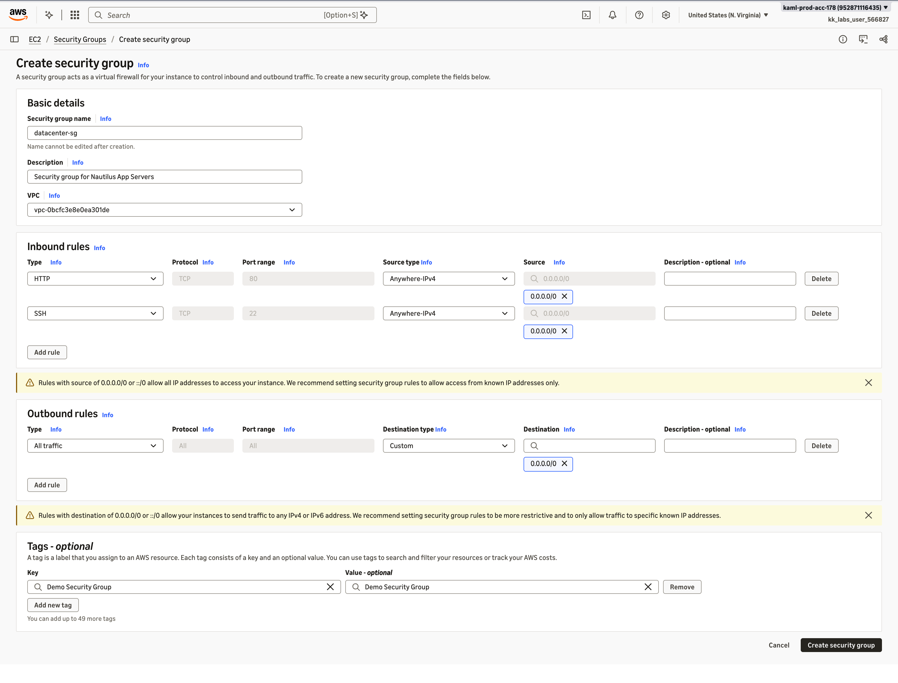
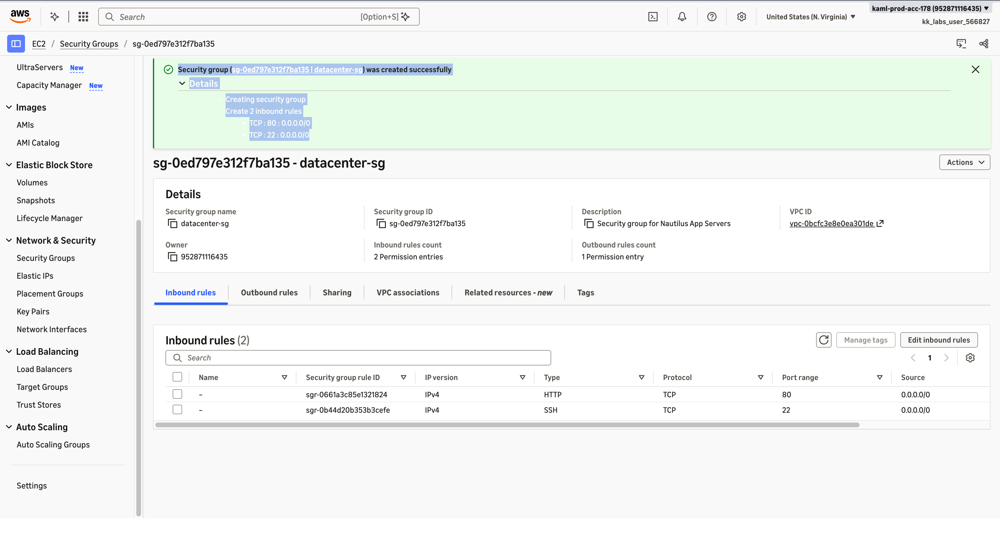
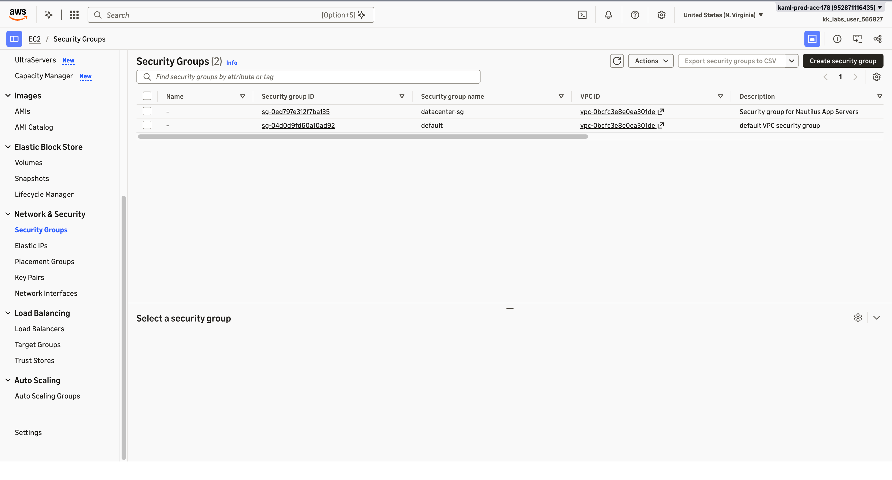
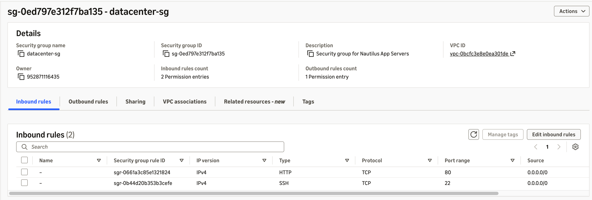
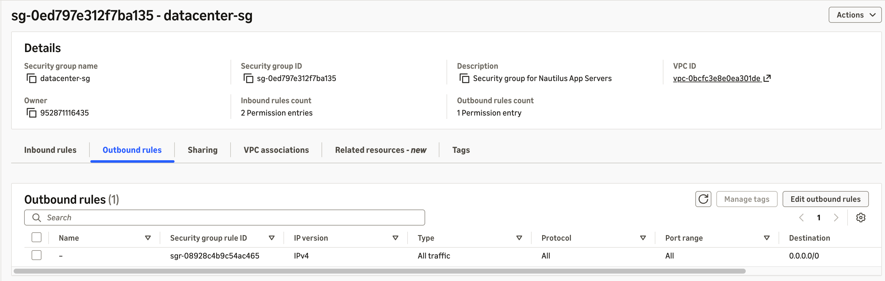
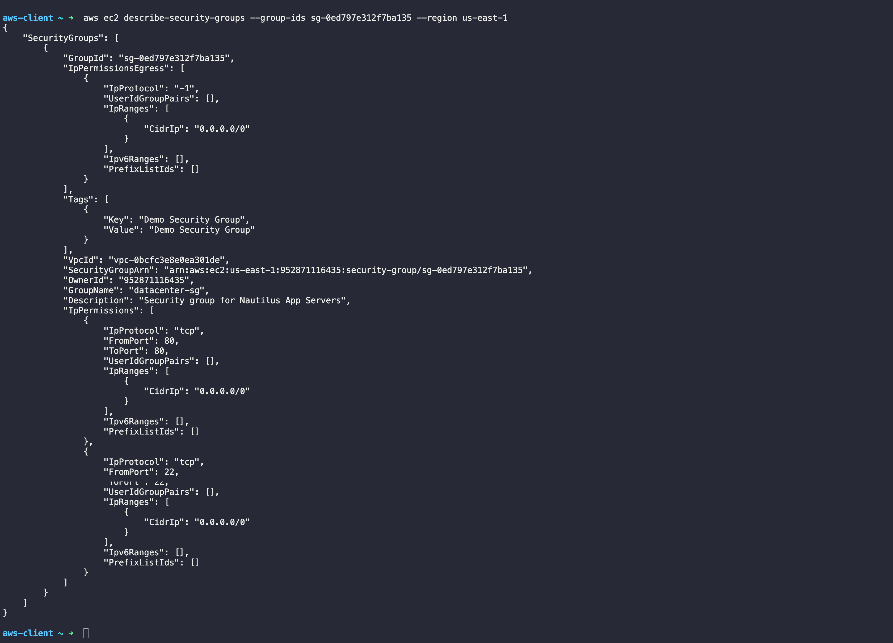
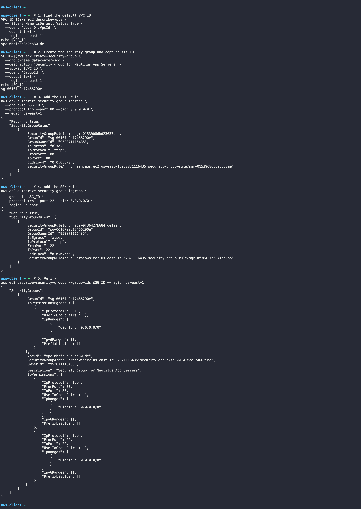

# Day - 2: Create Security Group

## Problem Statement

The Nautilus DevOps team is strategizing the migration of a portion of their infrastructure to the AWS cloud. Recognizing the scale of this undertaking, they have opted to approach the migration in incremental steps rather than as a single massive transition. To achieve this, they have segmented large tasks into smaller, more manageable units. This granular approach enables the team to execute the migration in gradual phases, ensuring smoother implementation and minimizing disruption to ongoing operations. By breaking down the migration into smaller tasks, the Nautilus DevOps team can systematically progress through each stage, allowing for better control, risk mitigation, and optimization of resources throughout the migration process.

For this task, create a security group under default VPC with the following requirements:

* Name of the security group is "datacenter-sg".

* The description must be "Security group for Nautilus App Servers"

* Add the inbound rule of type `HTTP`, with port range of `80`. Enter the source CIDR range of `0.0.0.0/0`.

* Add another inbound rule of type `SSH`, with port range of `22`. Enter the source CIDR range of `0.0.0.0/0`.

---

AWS Credentials to complete the task are provided by https://kodekloud.com when you start this challenge.

Notes:  

* Create the resources only in "us-east-1" region.

---

## Solution

# Day 2: Create a Security Group (`datacenter-sg`)

## Option A: AWS Console

1. **Sign in** using the credentials KodeKloud gives you for this task.
2. **Check the region** in the top-right corner. It must say **N. Virginia (us-east-1)**.
3. Open **EC2**, then in the left sidebar under **Network & Security**, click **Security Groups**.
4. Click **Create security group**.
5. Fill in **Basic details**:
   - **Security group name:** `datacenter-sg`
   - **Description:** `Security group for Nautilus App Servers`
   - **VPC:** leave the **default VPC** selected. It's marked "(default)" in the dropdown.
6. Under **Inbound rules**, click **Add rule** twice:

   | Type | Protocol | Port range | Source |
   |------|----------|------------|--------|
   | HTTP | TCP | 80 | Anywhere-IPv4 (`0.0.0.0/0`) |
   | SSH | TCP | 22 | Anywhere-IPv4 (`0.0.0.0/0`) |

7. Leave **Outbound rules** as they are (the default allows all outbound traffic).
8. Click **Create security group**.
9. **Verify:** open `datacenter-sg` and check the **Inbound rules** tab for both rules.

## Option B: AWS CLI (from the `aws-client` host)

```bash
# 1. Find the default VPC ID
VPC_ID=$(aws ec2 describe-vpcs \
  --filters Name=isDefault,Values=true \
  --query 'Vpcs[0].VpcId' \
  --output text \
  --region us-east-1)
echo $VPC_ID

# 2. Create the security group and capture its ID
SG_ID=$(aws ec2 create-security-group \
  --group-name datacenter-sgg \
  --description "Security group for Nautilus App Servers" \
  --vpc-id $VPC_ID \
  --query 'GroupId' \
  --output text \
  --region us-east-1)
echo $SG_ID

# 3. Add the HTTP rule
aws ec2 authorize-security-group-ingress \
  --group-id $SG_ID \
  --protocol tcp --port 80 --cidr 0.0.0.0/0 \
  --region us-east-1

# 4. Add the SSH rule
aws ec2 authorize-security-group-ingress \
  --group-id $SG_ID \
  --protocol tcp --port 22 --cidr 0.0.0.0/0 \
  --region us-east-1

# 5. Verify
aws ec2 describe-security-groups --group-ids $SG_ID --region us-east-1
```

In the verify output, look for `"GroupName": "datacenter-sg"`, the description, and two entries under `IpPermissions` (ports 80 and 22, both with `0.0.0.0/0`).

If you already created it in the console, don't run step 2 again. It would fail with `InvalidGroup.Duplicate`. Use only the verify command with `--group-names datacenter-sg` instead of `--group-ids`.

## Common mistakes to avoid

- Creating it in the wrong region or in a non-default VPC.
- A typo in the **description**. It can't be edited after creation, so you'd have to delete and recreate the group.
- Picking `Custom TCP` instead of the `HTTP` / `SSH` types. The ports are the same, but match the task wording.
- Using `My IP` as the source instead of `0.0.0.0/0`. The task asks for open access.

## Key Takeaways

1. **A security group is a virtual firewall** for resources like EC2 instances, attached at the network-interface level.
2. **Inbound is denied by default.** You only add *allow* rules. There are no deny rules in security groups.
3. **They are stateful.** If inbound traffic is allowed in, the response is automatically allowed out, with no matching outbound rule needed.
4. **Outbound allows everything by default**, which is why you didn't touch it.
5. **They are VPC-scoped.** A security group belongs to one VPC (and therefore one region), so it must be created in the right VPC.
6. **`0.0.0.0/0` means "the whole internet."** It's fine for a lab, but in production, restrict SSH to your own IP or a bastion/VPN range.
7. **Rules can change anytime; the name and description can't.** Rule changes apply immediately to the attached instances.
8. **This connects to Day 1:** a key pair (the lock and key) lets you authenticate, and the security group (port 22 open) lets the connection reach the instance at all.

---

## Verification

**AWS Console > Create Security Group**  



---

**AWS Console > Security Group Verification**  












---

**AWS CLI > Security Group Verification**  





