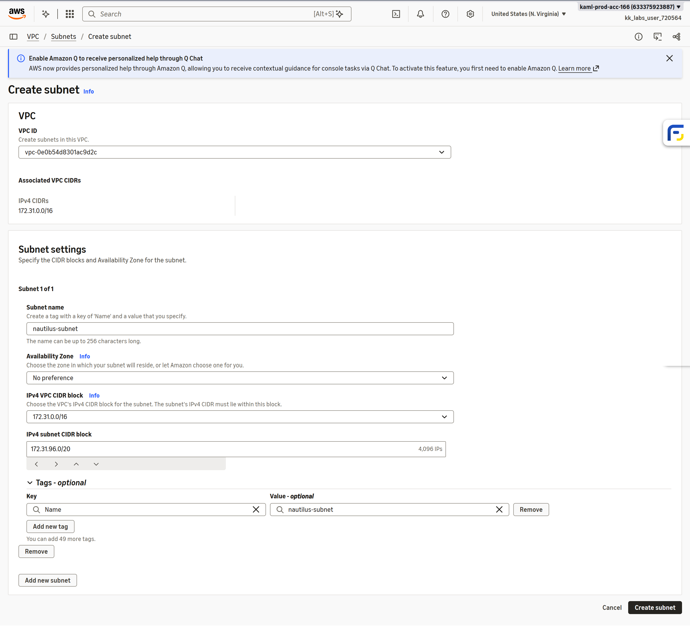
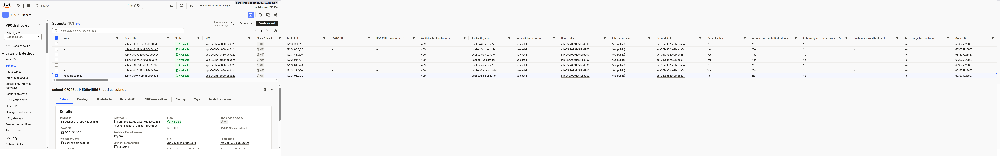
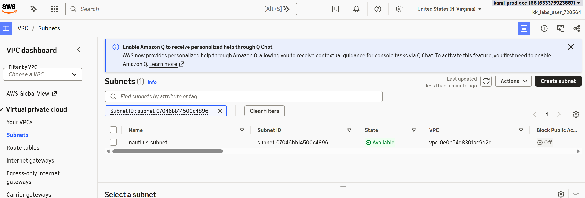
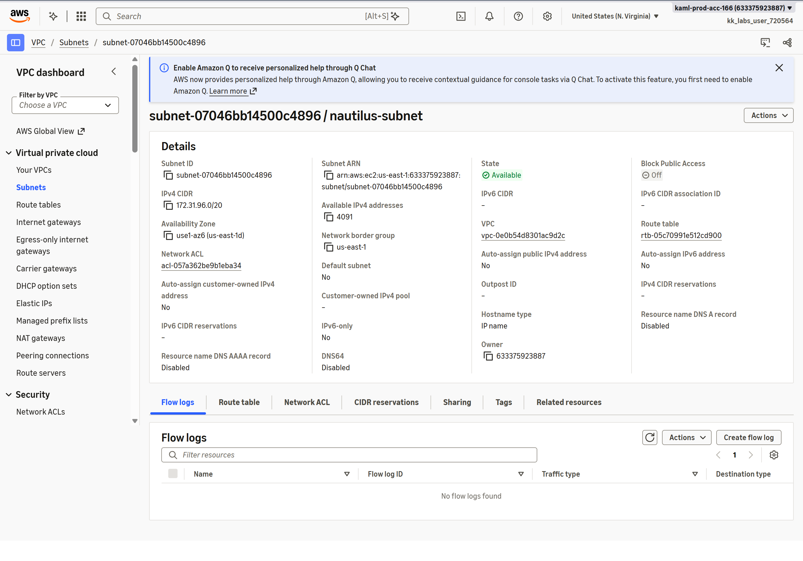
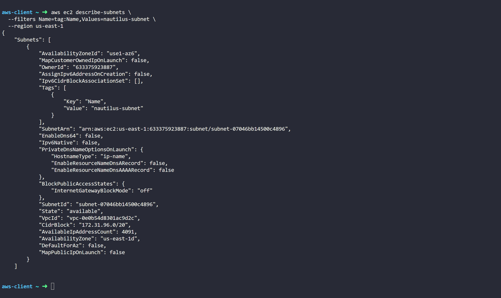
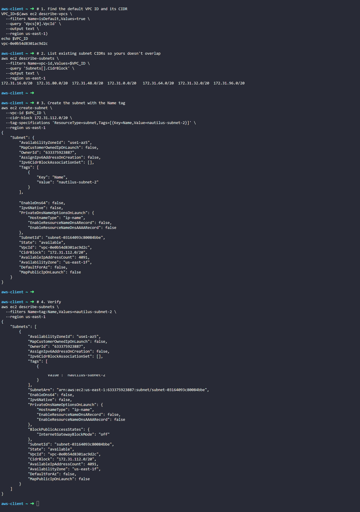

# Day - 3: Create Subnet

## Problem Statement

The Nautilus DevOps team is strategizing the migration of a portion of their infrastructure to the AWS cloud. Recognizing the scale of this undertaking, they have opted to approach the migration in incremental steps rather than as a single massive transition.

For this task, create one subnet named "nautilus-subnet" under default VPC.

---

AWS Credentials to complete the task are provided by https://kodekloud.com when you start this challenge.

Notes:  

* Create the resources only in "us-east-1" region.

---

## Solution

The task doesn't give a CIDR block, so you pick one. It must fall **inside the default VPC's range** and **not overlap** any existing subnet. The default VPC is normally `172.31.0.0/16`, and its default subnets use `172.31.0.0/20`, `172.31.16.0/20`, and so on up to about `172.31.80.0/20`. A safe free choice is **`172.31.96.0/20`**, but confirm in your lab first (see the CLI check below).

### Using AWS Console

1. **Sign in** with the credentials KodeKloud gives you.
2. **Check the region** in the top-right corner: **N. Virginia (us-east-1)**.
3. Open the **VPC** service (search "VPC"), then click **Subnets** in the left sidebar.
4. Optional but recommended: look at the existing subnets and note their **IPv4 CIDR** values so yours doesn't overlap.
5. Click **Create subnet**.
6. **VPC ID:** select the **default VPC** (the one with the "(default)" mark). The page then shows its CIDR.
7. Under **Subnet settings**:
   - **Subnet name:** `nautilus-subnet`
   - **Availability Zone:** `No preference` (or pick `us-east-1a`)
   - **IPv4 subnet CIDR block:** `172.31.96.0/20`
8. Click **Create subnet**.
9. **Verify:** `nautilus-subnet` appears in the Subnets list, with the default VPC and state `Available`.

### Using AWS CLI

```bash
# 1. Find the default VPC ID and its CIDR
VPC_ID=$(aws ec2 describe-vpcs \
  --filters Name=isDefault,Values=true \
  --query 'Vpcs[0].VpcId' \
  --output text \
  --region us-east-1)
echo $VPC_ID

# 2. List existing subnet CIDRs so yours doesn't overlap
aws ec2 describe-subnets \
  --filters Name=vpc-id,Values=$VPC_ID \
  --query 'Subnets[].CidrBlock' \
  --output text \
  --region us-east-1

# 3. Create the subnet with the Name tag
aws ec2 create-subnet \
  --vpc-id $VPC_ID \
  --cidr-block 172.31.96.0/20 \
  --tag-specifications 'ResourceType=subnet,Tags=[{Key=Name,Value=nautilus-subnet}]' \
  --region us-east-1

# 4. Verify
aws ec2 describe-subnets \
  --filters Name=tag:Name,Values=nautilus-subnet \
  --region us-east-1
```

In the verify output, look for `"State": "available"`, your `VpcId`, the `CidrBlock`, and a `Name` tag of `nautilus-subnet`.

If you already created it in the console, run only step 4.

### Common mistakes to avoid

- Picking a CIDR that **overlaps an existing subnet**. You'll get `InvalidSubnet.Conflict`.
- Picking a CIDR **outside the VPC range** (e.g. `10.0.1.0/24` in a `172.31.0.0/16` VPC). You'll get `InvalidSubnet.Range`.
- Forgetting the **name**. In the CLI, the name is a *tag* and isn't set unless you add `--tag-specifications`.
- Creating it in the wrong VPC or region.

### Key Takeaways

1. **A subnet is a slice of a VPC's IP range.** The VPC defines the big block (`/16`), and subnets carve it into smaller blocks (`/20`, `/24`).
2. **A subnet lives in exactly one Availability Zone.** It can't span AZs, so for high availability you create subnets in multiple AZs.
3. **CIDR rules:** the subnet CIDR must be inside the VPC CIDR and must not overlap other subnets.
4. **AWS reserves 5 IP addresses per subnet** (network address, VPC router, DNS, future use, broadcast). A `/20` has 4096 addresses, so 4091 are usable.
5. **Public vs private depends on the route table, not the name.** A subnet is public only if its route table has a route to an Internet Gateway.
6. **The name is just a tag** (`Name`). The real identifier is the subnet ID (`subnet-xxxx`).
7. **This builds on Days 1 and 2:** you'll launch an EC2 instance *into a subnet*, protect it with a *security group*, and log in with a *key pair*.

---

## Verification

**AWS Console > Subnet Verification**  









---

**AWS CLI > Subnet Verification**  





---

## Additional Todos

Need to learn/explore about the following:  

#1  
What is Subnet CIDR? How their range is defined?  

#2  
**A subnet is a slice of a VPC's IP range.** The VPC defines the big block (`/16`), and subnets carve it into smaller blocks (`/20`, `/24`).

#3  
**AWS reserves 5 IP addresses per subnet** (network address, VPC router, DNS, future use, broadcast). A `/20` has 4096 addresses, so 4091 are usable.  

What are those reserved IP addresses?  

#4  
**Public vs private depends on the route table, not the name.** A subnet is public only if its route table has a route to an Internet Gateway.  

Public?  
Private?  
Route table?  
Internet Gateway?  
