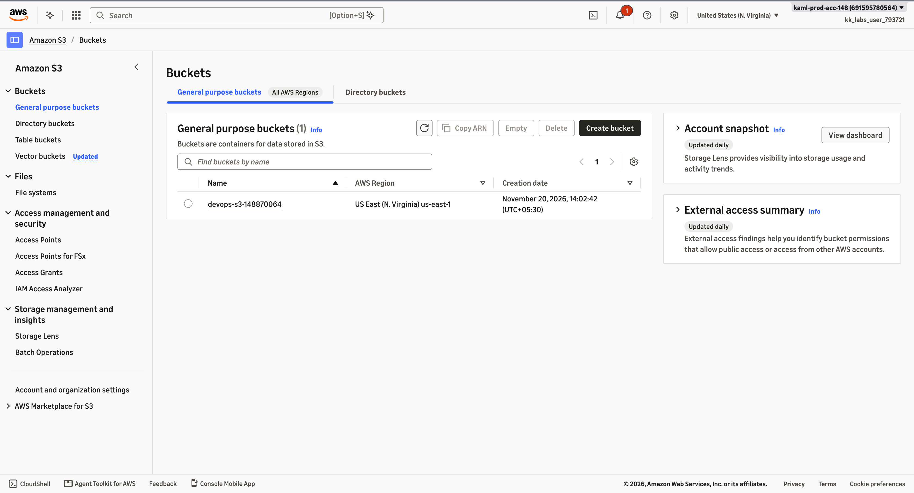
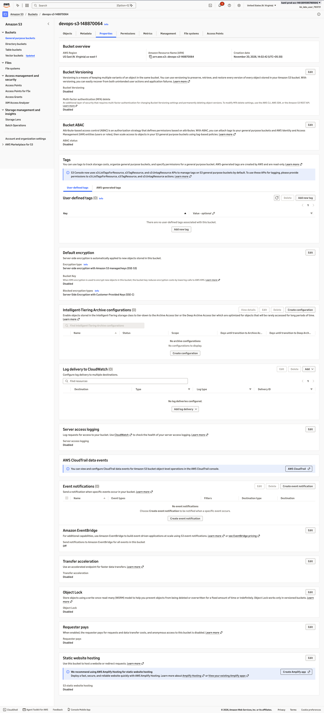
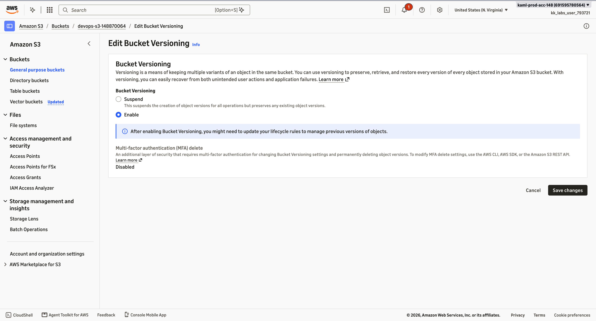
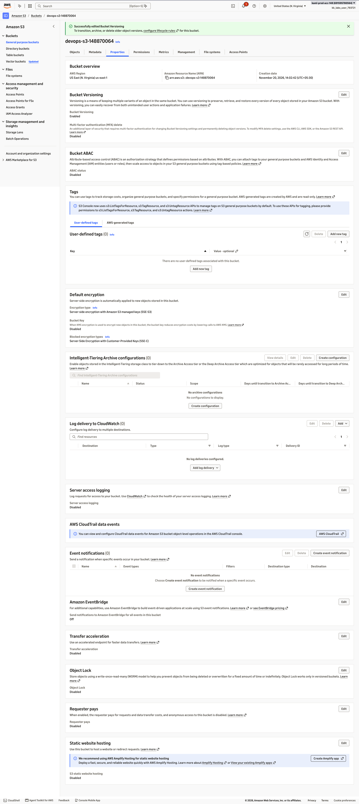
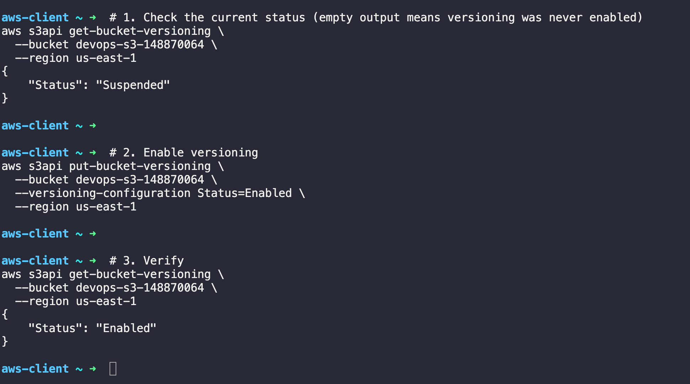

# Day 4: Enable Versioning for S3 Bucket

## Problem Statement

Data protection and recovery are fundamental aspects of data management. It's essential to have systems in place to ensure that data can be recovered in case of accidental deletion or corruption. The DevOps team has received a requirement for implementing such measures for one of the S3 buckets they are managing.

The s3 bucket name is "devops-s3-148870064", enable "versioning" for this bucket.

---

AWS Credentials to complete the task are provided by https://kodekloud.com when you start this challenge.

Notes:  

* Create the resources only in "us-east-1" region.

---

## Solution

The bucket already exists, so you only need to turn on versioning. You don't create anything.

### Using AWS Console  

1. **Sign in** with the credentials KodeKloud gives you.
2. **Check the region** in the top-right corner: **N. Virginia (us-east-1)**. S3 bucket names are global, but the console shows the bucket's own region.
3. Open **S3**, then click **General purpose buckets** in the left sidebar.
4. Click the bucket **`devops-s3-148870064`**.
5. Open the **Properties** tab.
6. Find the **Bucket Versioning** card and click **Edit**.
7. Select **Enable**.
8. Click **Save changes**.
9. **Verify:** the Bucket Versioning card now shows **Enabled**.

### Using AWS CLI

```bash
# 1. Check the current status (empty output means versioning was never enabled)
aws s3api get-bucket-versioning \
  --bucket devops-s3-148870064 \
  --region us-east-1

# 2. Enable versioning
aws s3api put-bucket-versioning \
  --bucket devops-s3-148870064 \
  --versioning-configuration Status=Enabled \
  --region us-east-1

# 3. Verify
aws s3api get-bucket-versioning \
  --bucket devops-s3-148870064 \
  --region us-east-1
```

The verify output should be:

```json
{
    "Status": "Enabled"
}
```

Use `s3api`, not `aws s3`. The `aws s3` commands are high-level helpers for copying and syncing files and have no versioning command.

### Try it out (optional, 2 minutes)

This shows what versioning actually does:

```bash
echo "v1" > test.txt
aws s3 cp test.txt s3://devops-s3-148870064/test.txt
echo "v2" > test.txt
aws s3 cp test.txt s3://devops-s3-148870064/test.txt

aws s3api list-object-versions \
  --bucket devops-s3-148870064 \
  --prefix test.txt
```

You'll see two versions of `test.txt`, each with its own `VersionId`. In a lab bucket this is harmless, but delete your test file afterwards. With versioning on, a plain delete only adds a delete marker, so the old versions remain.

### Common mistakes to avoid

- Using `aws s3 ...` instead of `aws s3api ...` for versioning.
- Typo in the bucket name. It must match exactly: `devops-s3-148870064`.
- Clicking **Suspend** instead of **Enable**. The two options look similar in the console.
- Trying to create a new bucket. The task says to enable versioning on the existing one.

### Key Takeaways

1. **Versioning keeps every version of an object.** Overwriting a file creates a new version instead of replacing the old one.
2. **Deletes become delete markers.** A normal delete doesn't remove data. It adds a marker, and you can recover by removing the marker or restoring an older version.
3. **It protects against accidental deletion and overwrites,** which is exactly the problem statement's goal.
4. **Once enabled, it can't be fully turned off.** You can only **suspend** it. Existing versions are kept, and new objects get a version ID of `null`.
5. **Versioning costs money.** Every stored version is billed as storage, so teams often add **lifecycle rules** to expire old versions.
6. **It's a prerequisite for other features,** such as cross-region replication and S3 Object Lock.
7. **Buckets have three versioning states:** Unversioned (default), Enabled, and Suspended.
8. **Bucket names are globally unique, but a bucket lives in one region.** That's why the task still mentions us-east-1.

---

## Verification

**AWS Console > Enable Versioning for S3 Bucket**  



---

**AWS Console > Enable Versioning for S3 Bucket Verification**  







---

**AWS CLI > Enable Versioning for S3 Bucket Verification**  


