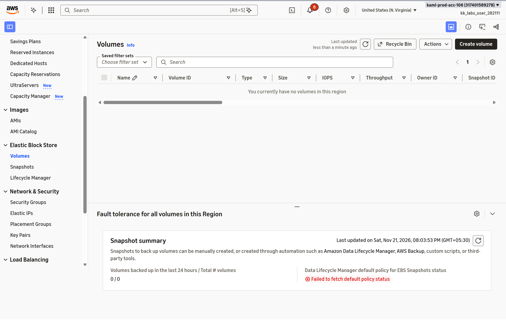
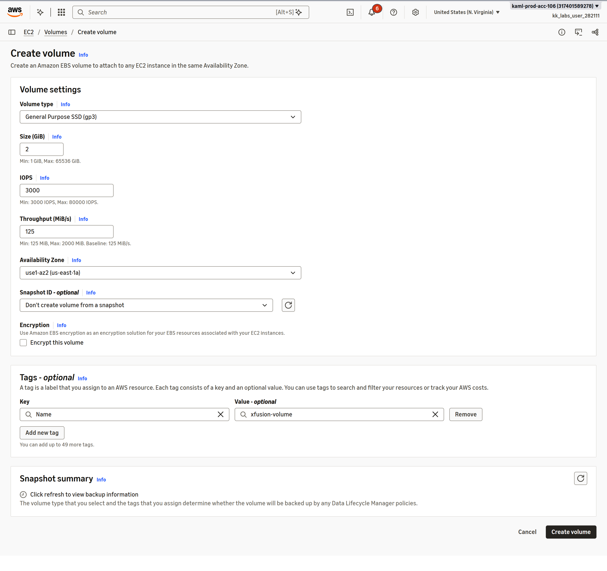
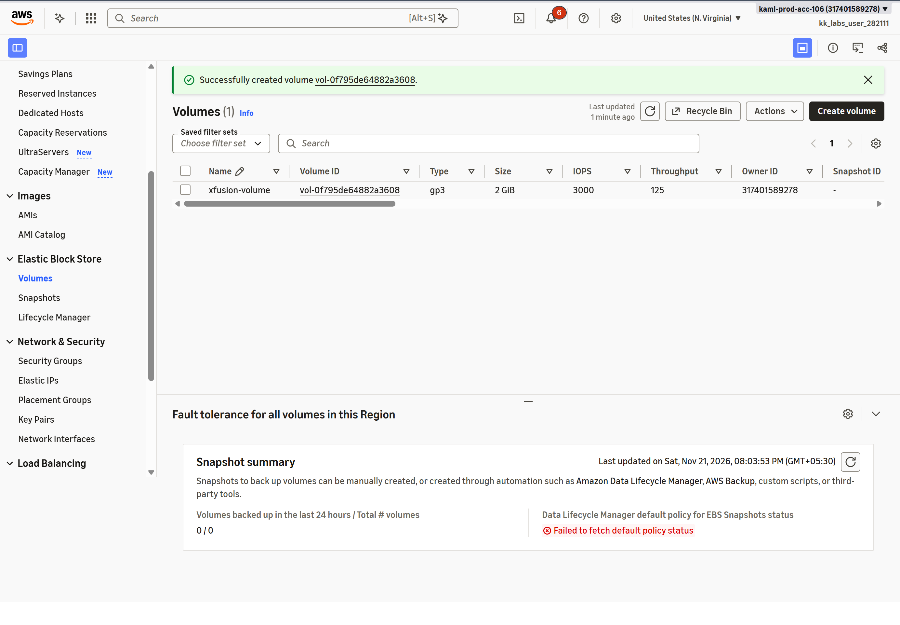
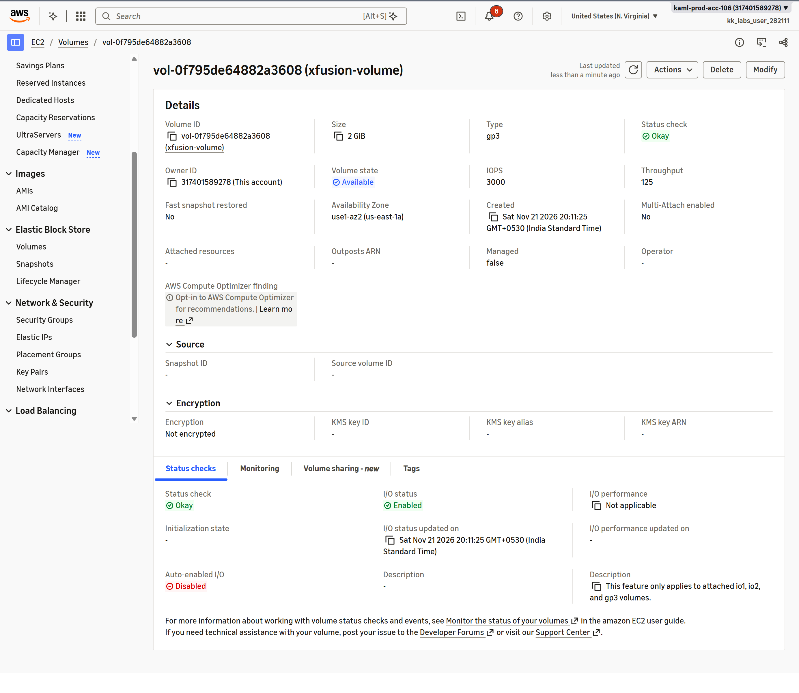
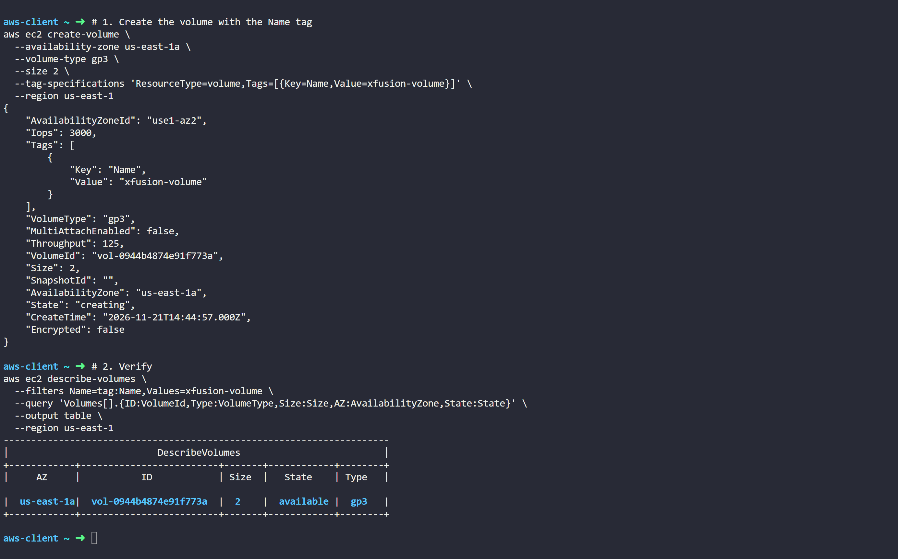

# Day 5: Create GP3 Volume

## Problem Statement

The Nautilus DevOps team is strategizing the migration of a portion of their infrastructure to the AWS cloud. Recognizing the scale of this undertaking, they have opted to approach the migration in incremental steps rather than as a single massive transition. To achieve this, they have segmented large tasks into smaller, more manageable units. This granular approach enables the team to execute the migration in gradual phases, ensuring smoother implementation and minimizing disruption to ongoing operations. By breaking down the migration into smaller tasks, the Nautilus DevOps team can systematically progress through each stage, allowing for better control, risk mitigation, and optimization of resources throughout the migration process.

Create a volume with the following requirements:  

* Name of the volume should be "xfusion-volume".

* Volume "type" must be "gp3".

* Volume "size" must be "2 GiB".

---

AWS Credentials to complete the task are provided by https://kodekloud.com when you start this challenge.

Notes:  

* Create the resources only in "us-east-1" region.

---

## Solution

The task doesn't specify an Availability Zone, but EBS volumes must live in one. Any AZ in `us-east-1` works, and `us-east-1a` is a safe pick.

### Using AWS Console

1. **Sign in** with the credentials KodeKloud gives you.
2. **Check the region** in the top-right corner: **N. Virginia (us-east-1)**.
3. Open **EC2**, then under **Elastic Block Store** in the left sidebar, click **Volumes**.
4. Click **Create volume**.
5. Fill in the form:
   - **Volume type:** `General Purpose SSD (gp3)`
   - **Size (GiB):** `2`
   - **IOPS / Throughput:** leave the defaults (3000 IOPS, 125 MiB/s)
   - **Availability Zone:** `us-east-1a`
   - **Snapshot ID / Encryption:** leave as is
6. Under **Tags**, click **Add tag**:
   - **Key:** `Name`
   - **Value:** `xfusion-volume`
7. Click **Create volume**.
8. **Verify:** `xfusion-volume` appears in the Volumes list with type `gp3`, size `2 GiB`, and state `Available`.

### Using AWS CLI

```bash
# 1. Create the volume with the Name tag
aws ec2 create-volume \
  --availability-zone us-east-1a \
  --volume-type gp3 \
  --size 2 \
  --tag-specifications 'ResourceType=volume,Tags=[{Key=Name,Value=xfusion-volume}]' \
  --region us-east-1

# 2. Verify
aws ec2 describe-volumes \
  --filters Name=tag:Name,Values=xfusion-volume \
  --query 'Volumes[].{ID:VolumeId,Type:VolumeType,Size:Size,AZ:AvailabilityZone,State:State}' \
  --output table \
  --region us-east-1
```

The verify table should show `gp3`, `2`, `us-east-1a`, and `available`.

If you already created it in the console, run only step 2. Running step 1 again would create a second volume, because volume names aren't unique and AWS won't reject the duplicate.

### Common mistakes to avoid

- Leaving the type as `gp2` or another type. Check that it says **gp3**.
- Entering the size in the wrong unit. The console and CLI both use **GiB**, so `2` means 2 GiB.
- Forgetting the **Name tag**. Without it, the volume has no name, and the task checks for `xfusion-volume`.
- Creating it in the wrong region.
- Creating duplicates by running the command twice. Check the Volumes list before creating again.

### Key Takeaways

1. **EBS is block storage for EC2,** like a virtual hard disk you can attach to an instance.
2. **A volume lives in one Availability Zone.** It can only attach to an instance in the same AZ. To move it, you take a snapshot and restore it elsewhere.
3. **gp3 is the modern general-purpose SSD.** It has a baseline of 3000 IOPS and 125 MiB/s regardless of size, and you can raise IOPS and throughput separately.
4. **gp3 vs gp2:** gp2 ties performance to size (about 3 IOPS per GiB), while gp3 decouples them and is roughly 20% cheaper per GiB.
5. **You can grow a volume but not shrink it.** You can also change the type later without detaching.
6. **You pay while the volume exists,** even when it's unattached (state `available`). Delete unused test volumes.
7. **Snapshots are the backup mechanism.** They're stored in S3 behind the scenes, and are incremental.
8. **The name is just a tag.** The real identifier is the volume ID (`vol-xxxx`).
9. **This builds on earlier days:** an instance runs in a subnet (Day 3), is protected by a security group (Day 2), and logged into with a key pair (Day 1). A volume is the disk you add to it.

---

## Verification

**AWS Console > Create GP3 Volume**  





---

**AWS Console > Create GP3 Volume Verification**  





---

**AWS CLI > Create GP3 Volume Verification**  


