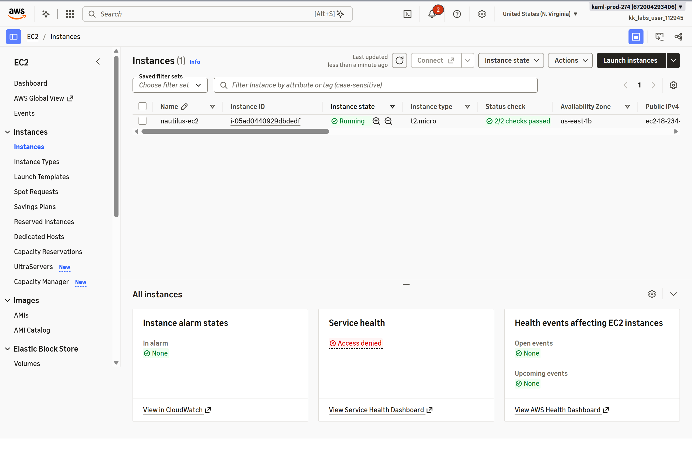
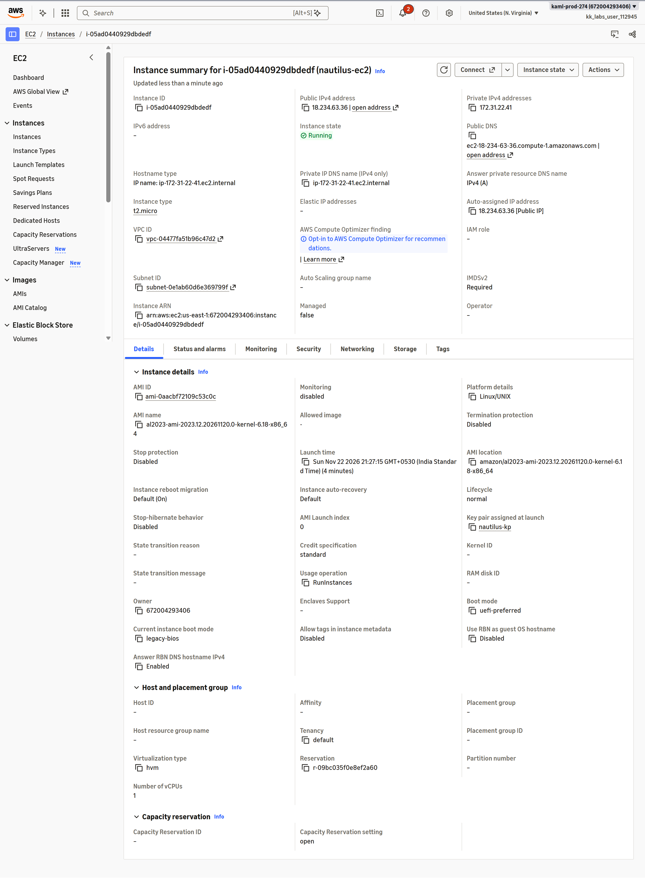
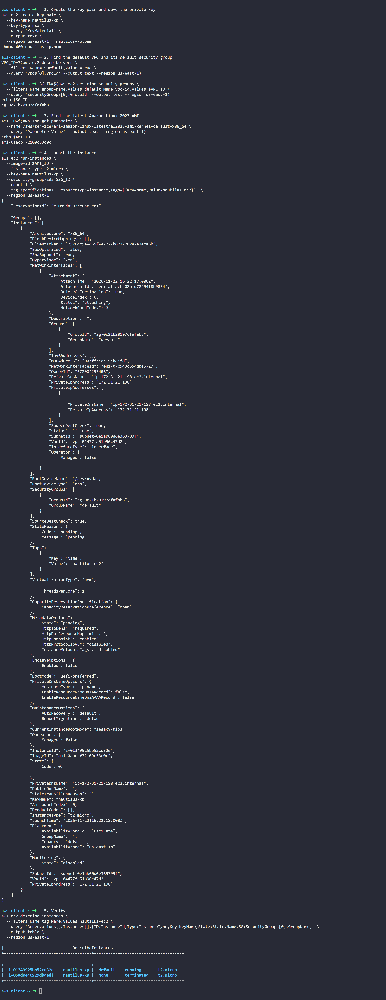

# Day 6: Launch EC2 Instance

## Problem Statement

The Nautilus DevOps team is strategizing the migration of a portion of their infrastructure to the AWS cloud. Recognizing the scale of this undertaking, they have opted to approach the migration in incremental steps rather than as a single massive transition. To achieve this, they have segmented large tasks into smaller, more manageable units.

For this task, create an EC2 instance with following requirements:

1) The name of the instance must be nautilus-ec2.

2) You can use the Amazon Linux AMI to launch this instance.

3) The Instance type must be t2.micro.

4) Create a new RSA key pair named nautilus-kp.

5) Attach the default (available by default) security group.

---

AWS Credentials to complete the task are provided by https://kodekloud.com when you start this challenge.

Notes:  

* Create the resources only in "us-east-1" region.

---

## Solution

This task combines everything from Days 1 to 5: an instance, a key pair, and a security group, all in one launch.

### Using AWS Console

1. **Sign in** with the credentials KodeKloud gives you.
2. **Check the region** in the top-right corner: **N. Virginia (us-east-1)**.
3. Open **EC2**, then click **Launch instance**.
4. **Name and tags:** `nautilus-ec2`
5. **Application and OS Images (AMI):** choose **Amazon Linux** (Quick Start tab), e.g. *Amazon Linux 2023 AMI*.
6. **Instance type:** `t2.micro`. The console may default to `t3.micro`, so change it if needed.
7. **Key pair (login):** click **Create new key pair**:
   - **Key pair name:** `nautilus-kp`
   - **Key pair type:** `RSA`
   - **Private key file format:** `.pem`
   - Click **Create key pair**. The `.pem` file downloads automatically.
8. **Network settings:** click **Edit**, then under **Firewall (security groups)** select **Select existing security group** and choose **`default`**.
9. Leave storage and everything else at the defaults.
10. Click **Launch instance**.
11. **Verify:** open **Instances** and wait for `nautilus-ec2` to show **Running** with the status checks passing, then confirm the type is `t2.micro` and the key pair is `nautilus-kp`.

### Using AWS CLI

```bash
# 1. Create the key pair and save the private key
aws ec2 create-key-pair \
  --key-name nautilus-kp \
  --key-type rsa \
  --query 'KeyMaterial' \
  --output text \
  --region us-east-1 > nautilus-kp.pem
chmod 400 nautilus-kp.pem

# 2. Find the default VPC and its default security group
VPC_ID=$(aws ec2 describe-vpcs \
  --filters Name=isDefault,Values=true \
  --query 'Vpcs[0].VpcId' --output text --region us-east-1)

SG_ID=$(aws ec2 describe-security-groups \
  --filters Name=group-name,Values=default Name=vpc-id,Values=$VPC_ID \
  --query 'SecurityGroups[0].GroupId' --output text --region us-east-1)
echo $SG_ID

# 3. Find the latest Amazon Linux 2023 AMI
AMI_ID=$(aws ssm get-parameter \
  --name /aws/service/ami-amazon-linux-latest/al2023-ami-kernel-default-x86_64 \
  --query 'Parameter.Value' --output text --region us-east-1)
echo $AMI_ID

# 4. Launch the instance
aws ec2 run-instances \
  --image-id $AMI_ID \
  --instance-type t2.micro \
  --key-name nautilus-kp \
  --security-group-ids $SG_ID \
  --count 1 \
  --tag-specifications 'ResourceType=instance,Tags=[{Key=Name,Value=nautilus-ec2}]' \
  --region us-east-1

# 5. Verify
aws ec2 describe-instances \
  --filters Name=tag:Name,Values=nautilus-ec2 \
  --query 'Reservations[].Instances[].{ID:InstanceId,Type:InstanceType,Key:KeyName,State:State.Name,SG:SecurityGroups[0].GroupName}' \
  --output table \
  --region us-east-1
```

The verify table should show `t2.micro`, `nautilus-kp`, `default`, and state `pending` or `running`.

If step 3 fails with a permissions error (the lab user may not have SSM access), look up an AMI directly instead:

```bash
AMI_ID=$(aws ec2 describe-images \
  --owners amazon \
  --filters 'Name=name,Values=al2023-ami-2023*-x86_64' 'Name=state,Values=available' \
  --query 'sort_by(Images, &CreationDate)[-1].ImageId' \
  --output text --region us-east-1)
```

If you launched it in the console already, don't repeat steps 1 and 4. You would get `InvalidKeyPair.Duplicate` and a second instance.

### Common mistakes to avoid

- **Leaving the security group on "Create security group".** The console's default creates a new `launch-wizard-1` group, but the task wants the existing **`default`** one.
- Picking an existing key pair instead of **creating a new** one named `nautilus-kp`.
- Leaving the instance type at `t3.micro` instead of `t2.micro`.
- A typo in the instance name. It's a tag, so a wrong value won't be flagged for you.
- Wrong region. AMI IDs and key pairs are both region-specific.

### Key Takeaways

1. **An EC2 instance is a combination of choices:** AMI (the OS image), instance type (CPU and memory), key pair (login), security group (firewall), and a subnet (network location).
2. **An AMI is a template** for the instance's root volume and settings. AMI IDs differ per region, so the same Amazon Linux image has a different ID in each one.
3. **`t2.micro` is a burstable instance** with 1 vCPU and 1 GiB of memory, and is free-tier eligible in many accounts.
4. **The default security group** allows inbound traffic only from other members of the same group and allows all outbound traffic. That means **you can't SSH into this instance yet**, since port 22 isn't open. To connect, you would attach a group like `datacenter-sg` from Day 2.
5. **The key pair is fixed at launch.** You can't swap it afterwards through the console, which is why you create it as part of the launch.
6. **With no subnet specified, the instance lands in a default subnet** of the default VPC and gets a public IP.
7. **Instance states:** `pending`, then `running`, then (optionally) `stopping`, `stopped`, `terminated`. You're billed for compute only while running, but attached EBS volumes cost money until deleted.
8. **For Amazon Linux, the SSH user is `ec2-user`** (as with `ssh -i nautilus-kp.pem ec2-user@<public-ip>` once port 22 is open).
9. **Cost tip:** if your lab doesn't require the instance to stay running after validation, terminate it to avoid charges in a real account.

---

## Verification

**AWS Console > Launch EC2 Instance**  


---

**AWS Console > Launch EC2 Instance Verification**  





---

**AWS CLI > Launch EC2 Instance Verification**  


